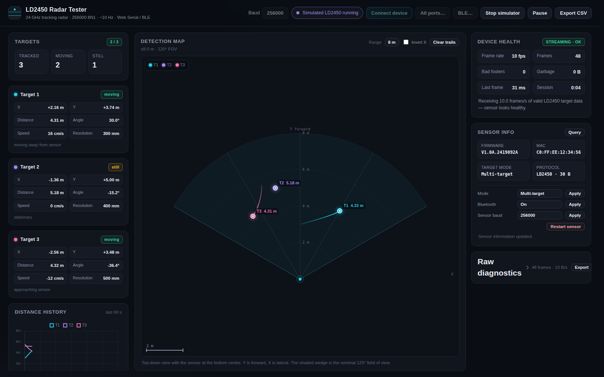

# LD2450 Radar Tester

A single-page TypeScript app for testing the **HLK-LD2450** 24 GHz human presence tracking radar in the browser over **Web Serial** or **Bluetooth LE**.



## What it shows

- **Three-column dashboard** with a live, top-down detection map in the centre.
- **Targets**: up to three tracked targets with X/Y position, distance, angle, speed/direction and distance resolution, plus a 60 s distance history chart.
- **Detection map**: sensor at the bottom centre, forward Y axis, ±60° field-of-view wedge, range rings, per-target coloured markers and 15 s trails. Range is selectable from 2–8 m and the X axis can be inverted for different mounting orientations.
- **Device health**: measured frame rate (~10 Hz expected), frame count, bad footers, garbage bytes, last-frame age and a verdict (STREAMING OK / DEGRADED / NO DATA / SIGNAL LOST).
- **Sensor info & settings**: firmware version, MAC, single/multi-target mode, Bluetooth on/off, sensor baud and restart. All use the LD2450 configuration command protocol and work over both serial and BLE.
- **Raw diagnostics**: byte rate, `0xAA`/`0xFD` signature counts, ACK/resync counters, hex dump and JSON diagnostics export.
- **CSV export**, pause/resume, clear trails, and a built-in simulator that generates real encoded LD2450 frames.

## Run it

```bash
npm install
npm run dev      # open the printed http://localhost:5173 URL
npm run build    # type-check + production build in dist/
npm test         # parser/command unit tests
```

Web Serial and Web Bluetooth require a **secure context** (`http://localhost` or HTTPS). Use Chrome, Edge or Opera on desktop; the simulator works everywhere.

## Connecting the sensor

The LD2450 UART defaults to **256000 baud, 8N1** (selectable in the top bar):

| LD2450 | USB-TTL adapter |
| ------ | --------------- |
| 5V     | 5V              |
| GND    | GND             |
| TX     | RXD             |
| RX     | TXD             |

Use **Connect device** for the filtered USB-UART list, or **All ports…** if your adapter is not a common bridge. Paired Bluetooth Classic SPP devices can appear in the serial picker too.

### BLE

**BLE…** accepts the sensor's native BLE service and common BLE-UART bridges:

- **LD2450 native**: service `FFF0`, notify `FFF1`, write `FFF2`
- **Nordic UART Service**: service `6e400001…`, TX notify `…0003`, RX write `…0002`
- **HM-10 / AT-09 / FFE0**: service `FFE0`, characteristic `FFE1`

BLE notifications carry the same 30-byte frames as the UART, so all readouts and diagnostics behave identically.

## Protocol notes

Periodic data frame (30 bytes):

```
AA FF 03 00 | target 1 (8 B) | target 2 (8 B) | target 3 (8 B) | 55 CC
```

Each target is `x i16, y i16, speed i16, distance resolution u16`, little-endian in **sign-magnitude** form (the high bit means positive, **not** two's complement). Coordinates are millimetres, speed is cm/s (positive = moving away). A target with X=Y=0 is inactive.

Configuration commands use `FD FC FB FA | len u16 | cmd | 00 | value | 04 03 02 01`; the matching ACK is `FD FC FB FA | len u16 | cmd | status | result u16 | value | 04 03 02 01`. The parser tolerates command ACKs interleaved with the periodic stream.

## Simulator

Press **Simulate**, or open `http://localhost:5173/?simulate=1` to start it automatically. The simulator:

- emits 10 Hz LD2450 data frames with three moving/still targets,
- answers firmware/MAC/mode/baud/Bluetooth/restart commands with real ACK frames,
- so the map, charts, settings and diagnostic paths can be exercised without hardware.

## Browser & hardware notes

- Web Serial needs Chromium on desktop. Web Bluetooth on Linux Chromium may require `--enable-blink-features=WebBluetooth`.
- The LD2450 detects up to 8 m with a nominal 120° horizontal field of view. Mounting height and orientation affect the reported coordinates; use **Invert X** if the map is mirrored for your installation.
- This is an independent tester, not an official Hi-Link product.